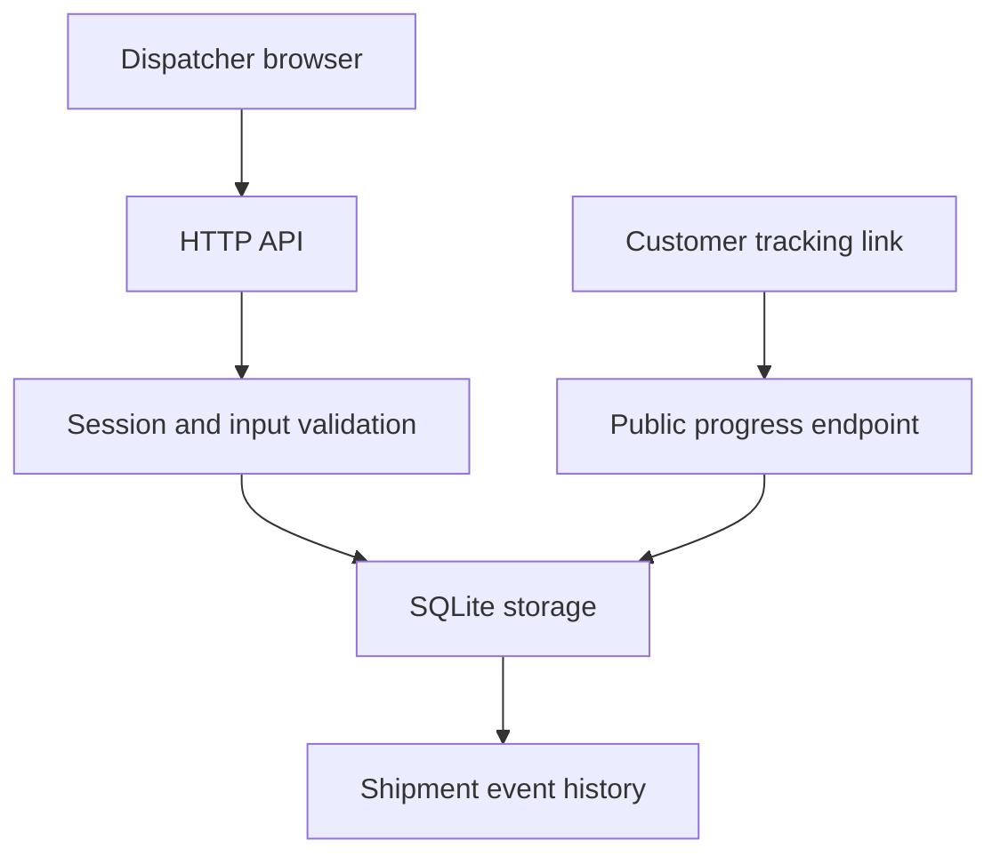

# Architecture

The browser loads static HTML, CSS and JavaScript from the same Python WSGI application as the JSON API. The API authenticates the dispatcher, validates inputs and calls the SQLite storage layer. Status changes and event inserts run in a single transaction.

| Table | Purpose |
| --- | --- |
| `drivers` | Driver identity, vehicle, phone and availability |
| `shipments` | Customer and address details, service, price in pence, driver, status and tracking token |
| `events` | Ordered, timestamped shipment history with private notes |
| `sessions` | SHA-256 hashes of random session tokens and expiry times |

Foreign keys link shipments to drivers and events to shipments. Parameterised queries keep submitted values out of SQL code. Random tracking tokens provide a separate public read path that returns a restricted projection of the shipment.

The frontend requests fresh data after writes and when the dispatcher presses Refresh. Customer tracking refreshes when requested. There is no WebSocket feed or GPS collector. Session expiry is enforced on every authenticated API request.

The current schema is initialised with `CREATE TABLE IF NOT EXISTS`. Future schema changes should introduce versioned migrations. The application is intended for modest single-instance workloads; SQLite calls and password verification are serialised by an application lock. Gunicorn uses one worker process so login rate limits remain shared across requests.
